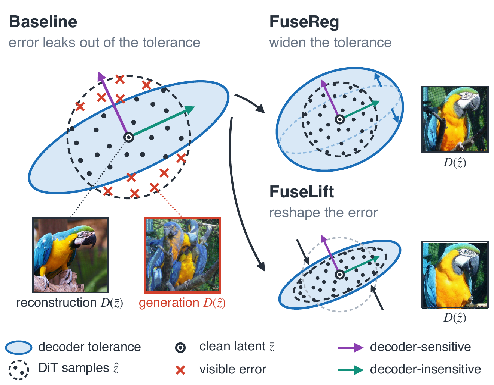
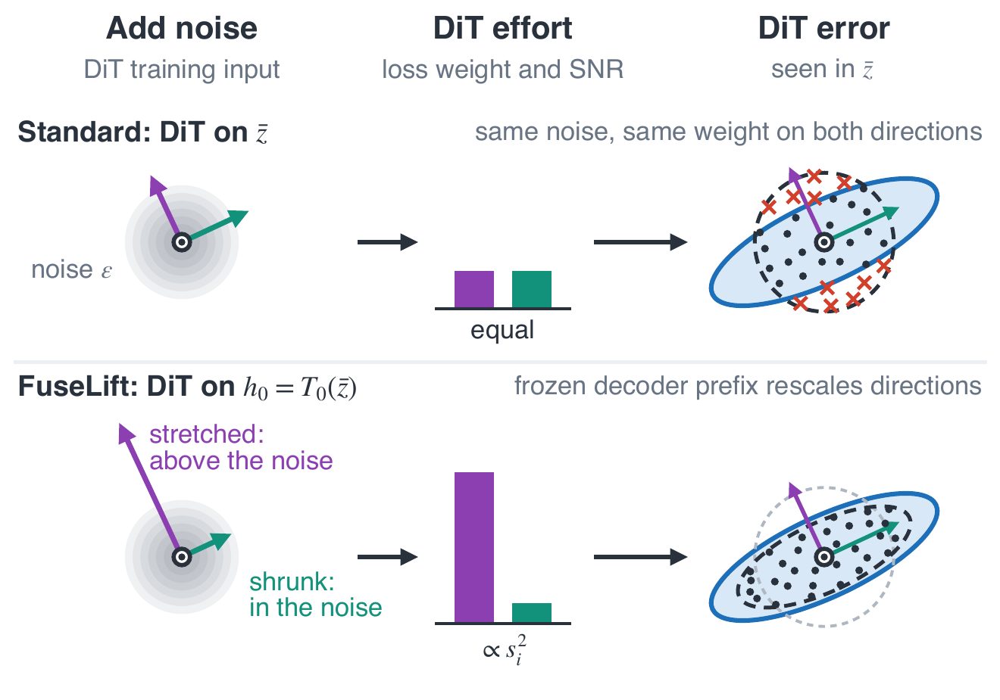
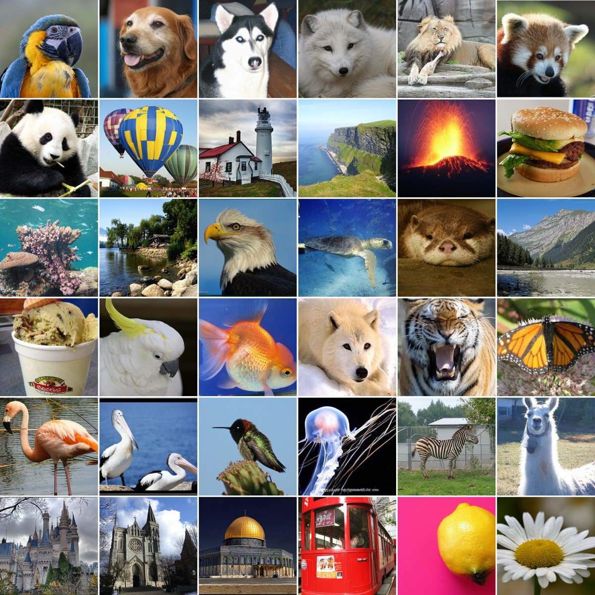
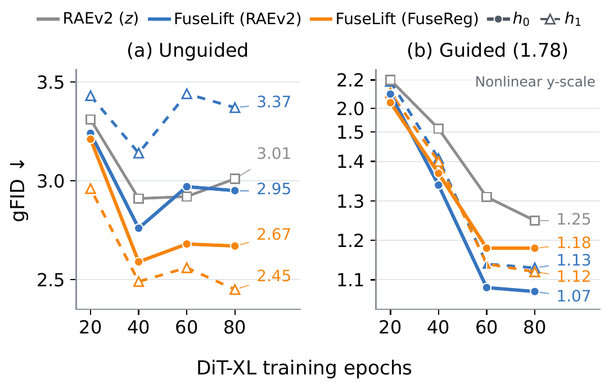
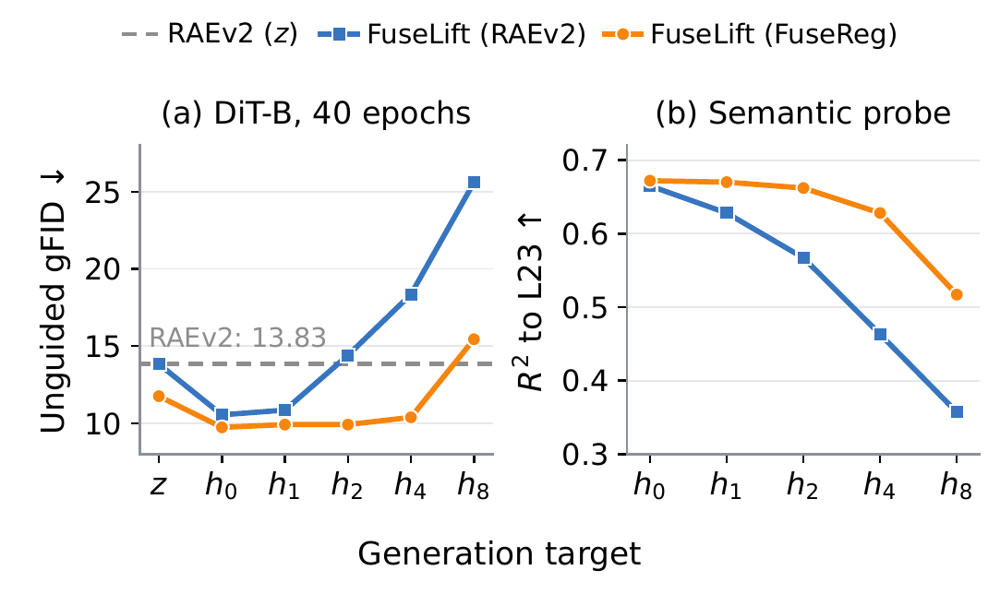

<div align="center">

# Rethinking the Reconstruction–Generation Gap in Representation Autoencoders


<p>
  <a href="https://arxiv.org/abs/2609.31620"></a>&nbsp;&nbsp;
  <a href="https://hongyang-du.github.io/FuseLift/"></a>&nbsp;&nbsp;
  <a href="https://huggingface.co/Hongyang-Du/FuseLift"></a>

</p>


**0.984 gFID · 2.14 FDr6** on class-conditional ImageNet-256 · DiT-XL · 80 epochs · 50 sampling steps

</div>

<p align="center">
  
</p>

Fusing shallower encoder layers into a Representation Autoencoder sharpens reconstruction and hurts
diffusion. The common explanation is that detail-rich latents are harder to model. This work holds the
latent's information fixed and shows that most of the penalty is **geometry**: diffusion makes the same
error in every latent direction, while the pixel decoder tolerates far less along some directions than
others. Two fixes follow, neither of which changes what the latent encodes:

- **FuseReg** trains the decoder on random layer subsets, so it tolerates more
  ([code](https://github.com/Hongyang-Du/FuseReg)).
- **FuseLift** (this repository) moves the diffusion model one linear layer into the frozen decoder, so its
  errors take the decoder's shape.

The [project page](https://hongyang-du.github.io/FuseLift/) walks through the argument with animations.

## Contents

- [How FuseLift works](#how-fuselift-works)
- [Results](#results)
- [Setup](#setup)
- [Reproduce the gFID](#reproduce-the-gfid)
- [Sample images](#sample-images)
- [Reproduce training](#reproduce-training)
- [What is in this repository](#what-is-in-this-repository)
- [Provenance and verification](#provenance-and-verification)
- [Citation](#citation)

## How FuseLift works

<p align="center">
  
</p>

The DiT diffuses **h0**, the state right after the frozen decoder's linear input projection, instead of
the fused encoder latent `z`:

```text
image -> DINOv3-L -> layer fusion + final-layer token mean          -> z   [1024, 16, 16]
      -> decoder_embed(z) + position embedding                      -> h0  [1152, 16, 16]   <- DiT target
h0 (sampled) -> all 28 decoder blocks -> pixels
```

`h0` is a fixed affine map of `z`, taken from the decoder that will read the sample, so every clean image
reconstructs exactly as before. The encoder and the decoder stay frozen and only the DiT is trained, with
the same architecture, loss, noise schedule and guidance as the `z`-space baseline. What changes is the
metric: the projection stretches the directions the decoder reads most strongly, which raises their
signal-to-noise ratio and their weight in the squared loss by the squared gain.

## Results

<p align="center">
  
</p>

ImageNet-256, 50,000 samples, 50 Euler steps, EMA weights. FID is computed against ImageNet **train**
statistics (the official RAEv2 reference). IG = internal guidance, scale 1.78 on t in [0.1, 1]. FDr6 is
the Fréchet distance in the features of six different networks, averaged. Each cell is gFID / IS / FDr6.

| Model | Fused layers | No guidance | IG 1.78 |
| --- | --- | --- | --- |
| FuseLift K=7 | 11, 13, ..., 23 | 1.77 / 208.8 / 4.00 | **0.984** / 253.4 / 2.14 |
| FuseLift K=23 | 1, 2, ..., 23 | 2.96 / 195.4 / 5.77 | 1.07 / 256.1 / 2.30 |

The headline number is K=7 on h0, epoch 80, EMA weights, IG 1.78, 50 Euler steps, sampling seed 1:
gFID 0.984 / IS 253.4 / FDr6 2.14.

At K=23, FuseLift brings guided gFID from 1.25 to 1.07 on the same decoder, which matches the K=7
encoder-space baseline (1.08) at 4.5 dB higher reconstruction PSNR.

<p align="center">
  
  
</p>

<details>
<summary>gFID during training, and the same decoder with a generator on <code>z</code></summary>

gFID during training (sampling seed 42, no guidance / IG 1.78):

| Model | Epoch 20 | Epoch 40 | Epoch 60 | Epoch 80 |
| --- | --- | --- | --- | --- |
| FuseLift K=7 | 2.44 / 2.11 | 1.88 / 1.32 | 1.78 / 1.02 | 1.76 / 1.01 |
| FuseLift K=23 | 3.24 / 2.10 | 2.76 / 1.34 | 2.97 / 1.08 | 2.95 / 1.08 |

Same K=7 decoder and protocol, generator on the encoder latent `z` (sampling seed 42):

| Generator (K=7, DiT-XL, 80 epochs) | No guidance | IG 1.78 |
| --- | --- | --- |
| official RAEv2 checkpoint, on `z` | 1.65 / 225.5 / 3.92 | 1.08 / 259.1 / 2.08 |
| our retraining on `z`, FuseLift schedule | 1.65 / 226.7 / 4.11 | 1.13 / 260.0 / 2.19 |
| FuseLift, on h0 | 1.76 / 209.2 / 3.97 | 1.01 / 253.4 / 2.13 |

The headline table uses sampling seed 1. Each number is one 50k evaluation of one training run.

</details>

## Setup

```bash
git clone https://github.com/Hongyang-Du/FuseLift.git && cd FuseLift
python3.11 -m venv .venv && source .venv/bin/activate
python -m pip install -r requirements.txt
python -m pip install '.[train]'          # GMuon optimizer, only needed for training
```

Download the checkpoints, decoders, released samples and FID reference statistics from
[Hugging Face](https://huggingface.co/Hongyang-Du/FuseLift):

```bash
hf download Hongyang-Du/FuseLift --local-dir checkpoints/fuselift                                # everything, 20 GB
hf download Hongyang-Du/FuseLift --include "k7/*" --local-dir checkpoints/fuselift               # K=7 model only, 5.2 GB
```

| File on the Hub | Size | Content |
| --- | --- | --- |
| `k7/ditxl_h0_raev2k7_ep080.safetensors` | 3.5 GB | FuseLift K=7 DiT-XL (`DiTwDDTHeadIG`, 876.2M parameters), EMA, epoch 80 |
| `k7/decoder_raev2k7.pt` | 1.7 GB | official RAEv2 DINOv3-L K=7 decoder, unchanged |
| `k7/h0_stats_raev2k7.pt` | 2 MB | per-position h0 mean and variance, mean decoder CLS token |
| `k23/...` | 5.2 GB | the same three files for K=23 |
| `samples/ditxl_h0_raev2k7_ep080_ig178_50k.npz` | 9.8 GB | the 50,000 guided K=7 samples behind 0.984 gFID (sampling seed 1) (`arr_0`, uint8 `[50000, 256, 256, 3]`, 50 per class) |
| `reference/imagenet_256_fid_stats.npz` | 34 MB | the FID reference behind every gFID here: Inception `mu` (`[2048]`) and `sigma` (`[2048, 2048]`) of ImageNet-256 train images, no images |

The decoders are byte-identical copies of the ones in
[nyu-visionx/RAEv2-models](https://huggingface.co/nyu-visionx/RAEv2-models).

Sampling needs no encoder. Training and statistics need the DINOv3-L weights
(`dinov3_vitl16_pretrain_lvd1689m-8aa4cbdd.pth`) in `pretrained_models/encoders/dinov3/` or in the
directory named by `DINOV3_CKPT_DIR`.

The two configs expect the Hub layout under `checkpoints/fuselift/`. Any path can be overridden on the
command line as `stage_1.params.<key>=<path>` (`stage1_ckpt_path` for the decoder, `lift_stats_path` for
the h0 statistics).

## Reproduce the gFID

The reported numbers come from [fd_evaluator](https://github.com/nanovisionx/nanogen-evals), scored against
ImageNet-256 **train** statistics. Install it once:

```bash
pip install --no-deps "git+https://github.com/nanovisionx/nanogen-evals.git@19dfb4c2705333eb8b97e454fb354d47d1fe135b#subdirectory=fd_evaluator"
```

The FID reference is `reference/imagenet_256_fid_stats.npz` in our Hub repository. It is an unchanged copy of
fd_evaluator's default reference from
[nanovisionx/nanogen-evals-stats](https://huggingface.co/datasets/nanovisionx/nanogen-evals-stats)
(SHA-256 `925e8b5b4ced42137f9847f97a63250a2bd59b70f33f3f356e03453d0775f1ac`), so passing it with `--fid-ref` or
leaving the flag out gives the same gFID. The per-extractor statistics for FDr6 download from that dataset on
first use into `~/.cache/nanogen-evals/stats/`. No ImageNet images are needed for gFID, IS or FDr6.

### 1. Score the released samples

This checks the headline number without running the model:

```bash
hf download Hongyang-Du/FuseLift --include "samples/*" "reference/*" --local-dir checkpoints/fuselift
python scripts/eval_npz.py checkpoints/fuselift/samples/ditxl_h0_raev2k7_ep080_ig178_50k.npz \
  --fid-ref checkpoints/fuselift/reference/imagenet_256_fid_stats.npz
# fid 0.984, inception_score 253.4, fdr6 2.14
```

### 2. Regenerate the samples from the checkpoint

Generate 50,000 guided samples, save them, and score them the same way:

```bash
python src/eval_fid_dit.py \
  --config configs/stage2/training/fuselift-h0-raev2k7-ditxl.yaml \
  --ckpt checkpoints/fuselift/k7/ditxl_h0_raev2k7_ep080.safetensors \
  --num-samples 50000 --batch 125 --steps 50 --seed 1 \
  --ig-scale 1.78 --ig-tmin 0.1 --ig-tmax 1.0 \
  --save-npz outputs/fuselift_k7_ig178_50k.npz --skip-fid \
  --grid outputs/fuselift_k7_ig178.png

python scripts/eval_npz.py outputs/fuselift_k7_ig178_50k.npz \
  --fid-ref checkpoints/fuselift/reference/imagenet_256_fid_stats.npz --out outputs/fuselift_k7_ig178.json
```

Drop the three `--ig-*` flags for the unguided number. For K=23 use `fuselift-h0-raev2k23-ditxl.yaml` and
`checkpoints/fuselift/k23/ditxl_h0_raev2k23_ep080.safetensors`. The released archive was
drawn with our internal sampling code at seed 1, so a fresh draw may not match it pixel for pixel; across
the two sampling seeds we evaluated, guided K=7 gFID was 0.984 (seed 1) and 1.01 (seed 42).

### 3. Other references

Without `--skip-fid`, `eval_fid_dit.py` also computes torch-fidelity FID and IS against images you provide,
either an archive (`--ref-npz data_eval/imagenet-256-val.npz`) or a sample of train images (`--data`).
The absolute value moves with the reference: guided FID against validation images is noticeably higher
than against train statistics. The released archive also works with any evaluator that takes a uint8
NHWC `.npz`, for example the ADM suite with its own reference batch.

## Sample images

```bash
python src/sample_dit.py \
  --config configs/stage2/training/fuselift-h0-raev2k7-ditxl.yaml \
  --ckpt checkpoints/fuselift/k7/ditxl_h0_raev2k7_ep080.safetensors \
  --classes 1 207 388 980 --per-class 4 --out outputs/fuselift_k7_grid.png
```

`sample_dit.py` samples without guidance.

## Reproduce training

Only the DiT is trained. The decoder comes from the Hub download above, and ImageNet train goes in
`data/imagenet`.

```bash
# 1. optional: h0 statistics (the released file is the one used for the checkpoint)
torchrun --standalone --nproc_per_node=1 src/compute_fuselift_stats.py \
  --config configs/stage2/training/fuselift-h0-raev2k7-ditxl.yaml \
  --num-samples 50000 --batch 64 --out checkpoints/fuselift/k7/h0_stats_raev2k7.pt \
  dataset.data_dir=data/imagenet

# 2. train: 8 GPUs x micro-batch 64 x 2 accumulation steps = global batch 1024
GRAD_ACCUM_OVERRIDE=2 torchrun --standalone --nproc_per_node=8 src/train.py \
  --config configs/stage2/training/fuselift-h0-raev2k7-ditxl.yaml \
  --results-dir outputs/fuselift-h0-raev2k7 --precision bf16 \
  dataset.data_dir=data/imagenet
```

For K=23, swap in `fuselift-h0-raev2k23-ditxl.yaml` and the `k23/` paths. The released checkpoints took
about 24 hours each on 2 x 8 H100.

| Setting | Value |
| --- | --- |
| Epochs, global batch | 80, 1024 |
| Optimizer | GMuon, lr 2e-4 held for 25 epochs, then linear decay to 2e-5 at epoch 50 |
| EMA | 0.9995 |
| Objective | x-prediction flow matching, logit-normal time sampling |
| Time shift | uses the h0 dimensionality, `time_dist_shift_dim = 1152 * 16 * 16` |
| Label dropout, gradient clipping | 0.1, 1.0 |
| Precision | bf16 |

**Other lift depths.** `stage_1.params.block_depth=k` diffuses the state after `k` decoder blocks and
decodes with the remaining ones. Recompute the statistics for each depth.

## What is in this repository

| Path | Content |
| --- | --- |
| `src/stage1/fuselift.py` | `RAEFuseLift`: encode images to h_k, decode h_k to pixels |
| `src/compute_fuselift_stats.py` | per-position h_k statistics and the mean decoder CLS token |
| `src/train.py` | DiT training loop |
| `src/sample_dit.py` | unguided class-conditional sample grids |
| `src/eval_fid_dit.py` | 50k sampling with optional internal guidance, sample archive, torch-fidelity FID / IS |
| `scripts/eval_npz.py` | gFID / IS / FDr6 of a sample archive with fd_evaluator |
| `configs/stage2/training/fuselift-h0-raev2k{7,23}-ditxl.yaml` | model, sampler and training recipe for the two released models |
| `configs/decoder/ViTXL/` | architecture of the frozen RAEv2 decoder |
| `src/stage2/` | DiT with DDT head (`models/DDT.py`) and flow-matching transport and samplers |
| `src/stage1/`, `src/encoders/`, `src/data/`, `src/utils/` | RAE, DINOv3 encoder, ImageNet loaders and helpers, unchanged from [FuseReg](https://github.com/Hongyang-Du/FuseReg) (commit `b8fb39c`) |
| `docs/` | source of the [project page](https://hongyang-du.github.io/FuseLift/) |

## Provenance and verification

The released checkpoints were trained with our internal training code on 2 x 8 H100 (global batch 1024,
bf16, about 24 hours each), not with this repository. The numbers in the tables come from that code as
well. This repository was checked against it on CPU in float32 with the same noise, 4 classes, 50 Euler
steps and IG 1.78:

| Check | K=7 | K=23 |
| --- | --- | --- |
| `RAEFuseLift.decode` on the same h0 | identical output | identical output |
| `RAEFuseLift.encode` (h0 target) on the same images | relative difference 1.4e-6 | relative difference 1.3e-6 |
| end-to-end samples (DiT + sampler + decode), saved as 8-bit PNG | 87.5 dB PSNR, 47 of 404,040 values differ by one level | 84.4 dB PSNR, 96 of 404,040 values differ by one level |

The end-to-end comparison covers two samples per model (classes 1 and 207).

Training through this repository has not been run end to end; the configs carry the same recipe and the
same h0 target.

## Citation

```bibtex
@misc{du2026rethinkingreconstructiongenerationgaprepresentation,
  title={Rethinking the Reconstruction-Generation Gap in
         Representation Autoencoders},
  author={Hongyang Du and Yunfei Xie and Junjie Ye and Jiawei Yang and
          Xiaoyan Cong and Haodong Zhang and Yongchao Huang and
          Haiyu Wu and Zongxia Li and Shihang Gui and Dawei Liu and
          Runhao Li and Jingcheng Ni and Chen Wei and
          Randall Balestriero and Yue Wang},
  year={2026},
  eprint={2609.31620},
  archivePrefix={arXiv},
  primaryClass={cs.CV},
  url={https://arxiv.org/abs/2609.31620},
}
```

## License

The code derives from RAEv2 through FuseReg and keeps the RAEv2 CC BY-NC 4.0 license (`LICENSE`,
`THIRD_PARTY_NOTICE.md`). The DINOv3 encoder and the RAEv2 decoders belong to their owners and are used
under their own terms.
